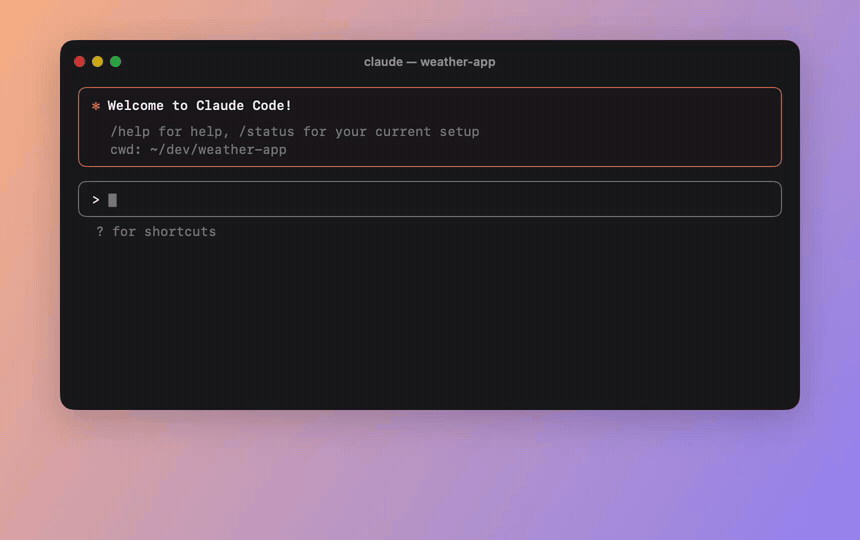
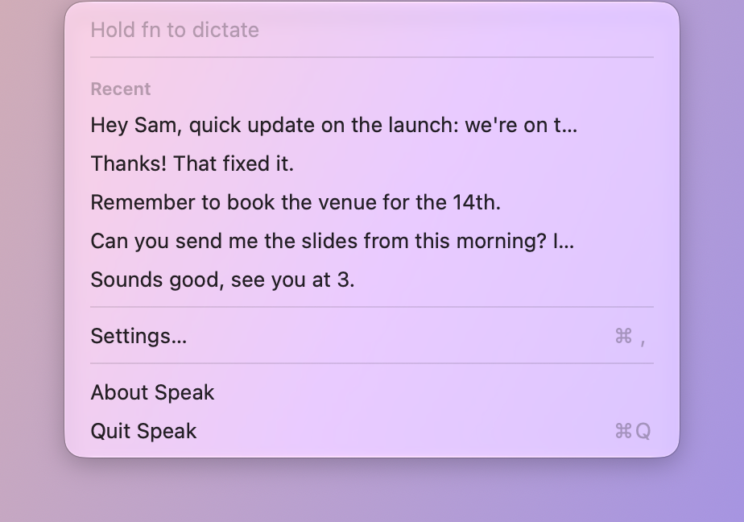

# Speak

Hold a key, talk, let go, and tidy text appears wherever your cursor is. A small, private take on
[Wispr Flow](https://wisprflow.ai) for macOS. Speech recognition and cleanup both run on your Mac,
so what you say never leaves it.



If Speak is useful to you, a star on the repo helps others find it.

## Requirements

- macOS 27 on Apple Silicon
- English
- Optional: Apple Intelligence turned on, for cleanup (removing "um"s, applying "no wait, Thursday"
  corrections, punctuation). Without it Speak pastes exactly what it heard.

## Using it

| | |
|---|---|
| **Hold fn** | Dictate while held; release to paste |
| **Double-tap fn** | Hands-free: keeps listening until you press fn again |
| **Esc** | Cancel |

While you talk, a card above the pill shows the text as it's recognized; every couple of sentences the
cleaned-up version replaces the raw words. Line breaks and punctuation come from the cleanup, not from
spoken commands.

Each pasted dictation ends with a space, so you can stop and start again without the sentences running
together. Turn it off in Settings.

The trigger key can be changed to right Option or right Command in Settings (handy for keyboards
without a fn/Globe key). The menu bar icon shows recent dictations: click one to copy it, or hold ⌥
to copy what you actually said before cleanup.



## Setup

On first launch Speak asks for:

- **Microphone**: to hear you while you hold the trigger key. Audio is never saved.
- **Accessibility**: to notice the trigger key and paste where your cursor is.
- **System Settings → Keyboard → "Press 🌐 key to" → Do Nothing**: only if you use fn, so the key
  doesn't also open emoji or dictation.

If another app also listens to the fn/Globe key, pick a different trigger key in one of them.

## Privacy

Audio goes from the microphone straight to Apple's on-device speech recognizer and is discarded.
The last 100 dictations (text only) are kept in `~/Library/Application Support/Speak/history.json`
for the menu; clear them from Settings.

Speak makes two kinds of network request, and you can turn off both in Settings:

- **Update check.** About once a day, if you allow it, Speak downloads a small feed file from
  `stoupe.github.io` to see whether there's a new version. It sends nothing about you or your dictations,
  only what any web request carries (your IP address, and Speak's version in the user agent). You can also
  use Check for Updates… from the menu instead.
- **Anonymous usage stats** (described below).

The first time you use Speak, macOS may also download Apple's on-device speech model.

### Usage stats

Speak is made by one person. Knowing how many people use it, and how, is how I decide what to fix and
build next. So Speak can send one small, anonymous summary a day. You choose whether it does when you set
Speak up (or after updating), and you can change your mind any time in Settings.

When it's on, Speak counts on your Mac during the day, then sends the previous day's totals once to
`speak-telemetry.stoupe.dev`. If that fails, the day is skipped, not retried. Nothing is sent on days you
don't use Speak. **Show What's Sent** in Settings shows the exact report from your Mac. A report looks like
this:

```json
{"app":"0.3","build":40,"cancelled":0,"chip":"Apple M1","day":"2026-11-05","dictations":14,"empty":1,
 "handsFree":2,"hold":12,"intelligence":true,"locale":"en-NZ","os":"27.0","polish":true,"trigger":"fn",
 "v":1,"words":320}
```

| Field | What it is | Why |
|---|---|---|
| `v` | Report format version | So the server can read old and new versions |
| `day` | The date the counts are for | Daily active use, trends over time |
| `app` | Speak version | What to support, whether updates reach people |
| `build` | Speak build number | Same, more precisely |
| `os` | macOS version (e.g. 27.0) | Which macOS versions to test on |
| `chip` | Mac chip (e.g. Apple M1) | Speed problems, mainly on older Macs |
| `locale` | Language and region (e.g. en-NZ) | Which languages to support next |
| `trigger` | Trigger key (fn, right ⌥ or right ⌘) | Whether the other keys are worth keeping |
| `polish` | Whether "Polish text" is on | Whether cleanup earns its place |
| `intelligence` | Whether Apple Intelligence is available | How many people get cleanup at all |
| `dictations` | Dictations that pasted text | How much Speak is used |
| `words` | Words dictated, rounded to the nearest 10 | Short notes or long writing |
| `hold` | Dictations made holding the key | Which way people use it |
| `handsFree` | Dictations made hands-free (double-tap) | Whether hands-free is worth more work |
| `empty` | Dictations where nothing was recognized | Microphone or recognition problems |
| `cancelled` | Dictations cancelled with Esc | Trigger problems: starting by accident |

Never sent: what you said (text or audio), app or window names, your dictionary, or any ID for you or your
Mac. Speak doesn't mark reports from the same Mac as related.

On the server, a report is checked against exactly the fields above and stored with the date it arrived.
IP addresses are not stored, and request logging is off. Reports are deleted after 13 months. The code is
all here: what's counted and the report format in
[`UsageStats.swift`](Packages/SpeakKit/Sources/SpeakCore/UsageStats.swift), when and how it's sent in
[`Telemetry.swift`](Speak/App/Telemetry.swift), and the receiving end in [`server/telemetry`](server/telemetry).
Builds you make yourself never send anything.

## Building

```sh
open Speak.xcodeproj    # set your own team under Signing & Capabilities, then Run
```

Development notes are in `CLAUDE.md` and the roadmap in `PLAN.md`.

## License

MIT. See [LICENSE](LICENSE).
